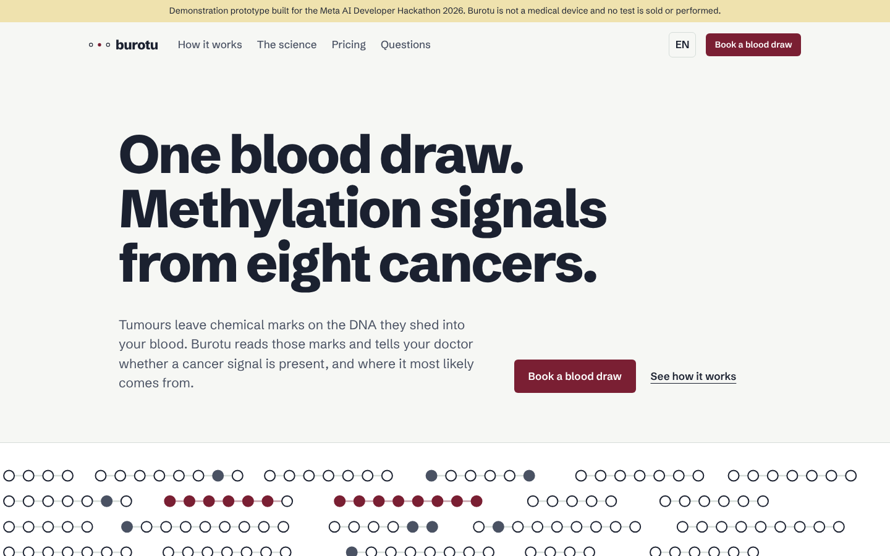
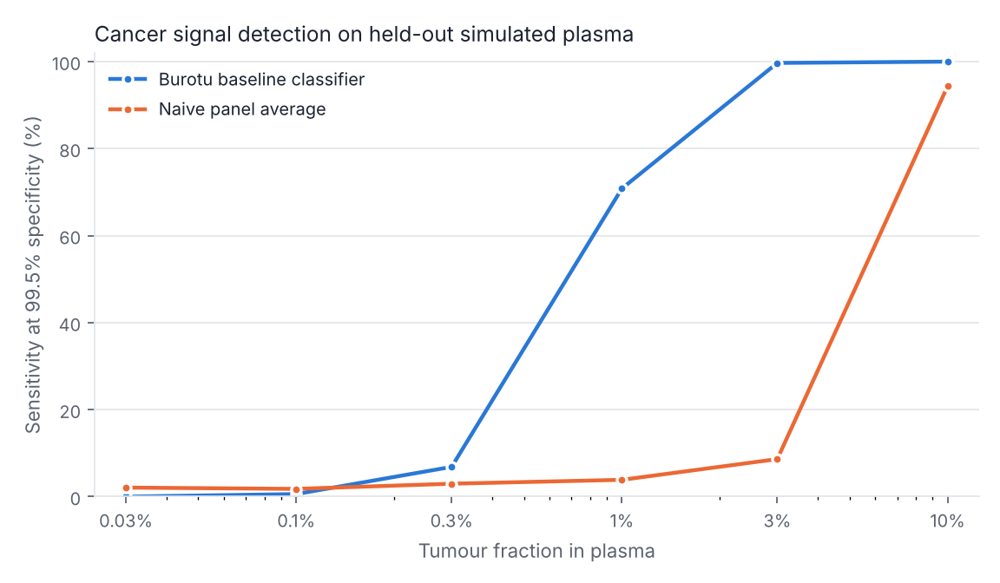
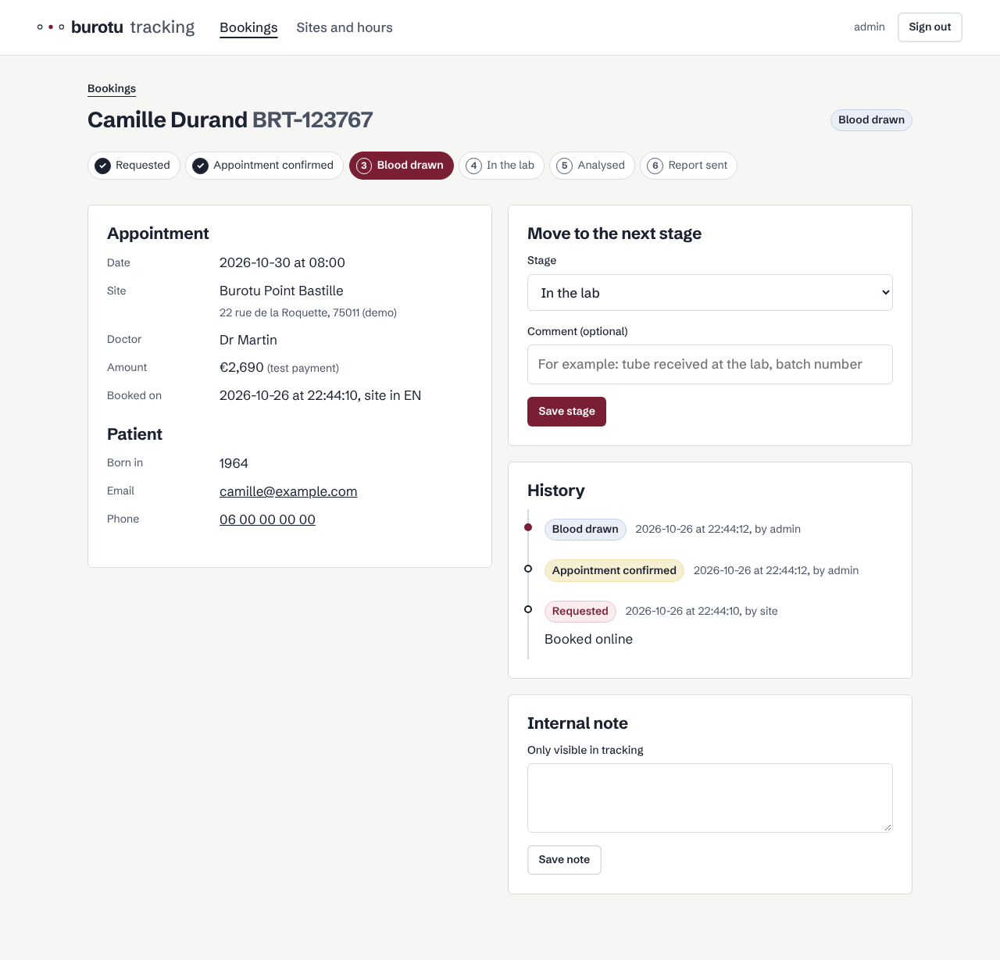

<p align="center">
  
</p>

<h1 align="center">Burotu</h1>

<p align="center">
  <strong>50 cancers. One blood draw.</strong><br>
  Teaching Meta's Muse models to read the DNA that tumours leave in our blood.
</p>

<p align="center">
  <a href="https://burotu.com">Live demo</a> ·
  <a href="#how-meta-models-power-burotu">Meta models</a> ·
  <a href="#muse-glimmer-learns-to-read-methylation">Muse Glimmer adapter</a> ·
  <a href="#benchmark">Benchmark</a> ·
  <a href="#quick-start">Quick start</a>
</p>

> [!IMPORTANT]
> **Demonstration prototype** built for the Meta Global AI Developer Hackathon 2026 (indie track,
> *Push the Frontier*). Burotu is not a medical device, is not clinically validated, has no CE
> marking and must not be used to make any medical decision. Nothing is sold: payments run in test
> mode only.

## The idea

Most cancers are found late, once symptoms appear. Screening exists for only a handful of them,
and each one needs its own exam. Yet tumours shed fragments of their DNA into the bloodstream from
early on, and that DNA carries a chemical signature, **methylation**, that reveals both *that* it
is cancerous and *which tissue* it comes from.

Language models already read text, code and images. Burotu asks a simple question: **can a Meta
model learn to read methylation too?** We give Meta's open-weight **Muse Glimmer** a new input, a
blood sample, and teach it to answer two questions: is there a cancer signal, and where does it
most likely come from? **Muse Spark** then turns that answer into something a patient can
understand.

## How Meta models power Burotu

```
Blood draw ─► Partner lab ─► burotu-bmc file (read counts on 3,148 CpG sites)
                                   │
                                   ▼
                   ┌───────────────────────────────────────┐
                   │ Muse Spark · quality control          │  Is this lab file trustworthy?
                   └───────────────────┬───────────────────┘
                                       ▼
                   ┌───────────────────────────────────────┐
                   │ Benchmark classifier · cancer signal  │  Alarm at 99.8% specificity
                   │ Muse Glimmer + methylation adapter    │  Which tissue does it come from?
                   │ (open weights, fine-tuned, QLoRA)     │
                   └───────────────────┬───────────────────┘
                                       ▼
                   ┌───────────────────────────────────────┐
                   │ Muse Spark · report and Q&A           │  Plain language, EN / FR / ES
                   └───────────────────────────────────────┘
```

| Step | Meta model | What it does | Status |
| --- | --- | --- | --- |
| Name the tissue of origin | **Muse Glimmer** (open weights, 30B) + methylation adapter + QLoRA | Ranks the likely tissues of origin once a cancer signal is found | Trained on Modal, beats the benchmark at low tumour DNA |
| Check lab data | **Muse Spark** (Meta Model API) | Reads coverage and lab metadata, flags files that cannot be trusted and says what to rerun | Client ready |
| Explain the result | **Muse Spark** | Writes a careful report and answers follow-up questions, grounded in the model's output | Client ready |

A gradient-boosted classifier raises the alarm and serves as the **benchmark**: every claim about
Muse is measured against it on the same held-out data.

## Muse Glimmer learns to read methylation

Feeding 3,148 numbers to a language model as text does not work well: the model reads digits, not
biology. Burotu follows the recipe that taught language models to see images instead.

```
read counts ─► binomial z-scores ─► methylation adapter (MLP) ─► 16 soft tokens
  (3,148 CpG)    vs healthy blood                                      │
                                                                       ▼
                              "Cancer signal: yes. Most likely origin: colorectal (0.71) ..."
                                                     ▲
                              Muse Glimmer 30B, 4-bit, LoRA adapters ──┘
```

- **Adapter**: a small network projects the sample into a handful of embeddings that live in
  Glimmer's token space, the same idea as vision projectors in multimodal models.
- **Fine-tuning**: QLoRA on Glimmer in 4-bit on one 48 GB L40S, following Meta's recipe. Two
  stages: the adapter alone first (500 steps), then adapter and LoRA together (1,000 steps).
  Training both from the start failed: LoRA learned the answer format faster than the adapter
  learned to carry the sample, and the model answered the same for everyone.
- **Training data**: tens of thousands of plasma samples simulated from the training split only.
- **Evaluation**: the exact held-out people, tumours and threshold protocol used for the
  benchmark below.
- **Compute**: Modal serverless GPUs, through the hackathon's partner credits.

The recipe is reusable: any open-weight Meta model could learn to read other omics data the
same way.

## Benchmark

The bar Muse Glimmer has to clear, on **20 tissue types**. Simulated plasma built only from
**held-out people and tumours**; the detection threshold is set on blood donors no model ever saw.

<p align="center"></p>

| Tumour fraction in plasma (20 tissue types) | 0.3% | 1% | 3% | 10% |
| --- | --- | --- | --- | --- |
| Cancer signal detected, classic model | 9% | 71% | 97% | 99.6% |
| Tissue of origin top-1, classic model (chance: 5%) | 15% | 55% | 88% | 93% |
| Tissue of origin top-2, classic model | 26% | 70% | 94% | 97% |
| Cancer vs healthy AUC, classic model | 0.81 | 0.98 | 1.00 | 1.00 |
| Tissue of origin top-1, **Muse Glimmer** (v5) | 15% | **60%** | 88% | 92% |
| Tissue of origin top-2, **Muse Glimmer** (v5) | 27% | **73%** | 94% | 96% |

Specificity measured on unseen healthy donors: **99.9%** (target 99.5%). Testis (21% caught at
1%) and thymus (31%) are the weak spots; brain (93%), prostate (95%) and breast (90%) the strong
ones. Muse Glimmer v5, trained on the same 20 types with pseudo-donors, names the tissue better
where it is hardest (60% vs 55% right first time at 1% tumour DNA) and as well above it; on real
patient plasma it gets 7 of 11 tissues right, against 6 for the classic model. Its alarm still does
not hold 99.5% specificity on new people (38% of signals found at 1%), so the classic model keeps
that job. Reports: [`reports/baseline.json`](reports/baseline.json),
[`reports/muse_glimmer-v5.json`](reports/muse_glimmer-v5.json).

**20 tissues, about 27 cancer categories.** Multi-cancer tests count "types" with the AJCC
staging manual, where one organ can count several times (five soft tissue sarcoma sites, three
bile duct categories). Burotu names tissues instead. Counted the AJCC way, the public tumours
behind our 20 tissues cover about 27 categories (table on the
[technology page](https://burotu.com/en/technology#coverage)). The others (ovary, bile ducts,
small intestine, neuroendocrine tumours, blood cancers...) are missing from public methylation
data: reaching 50 needs a partner lab's sequenced samples.

**What Muse Glimmer learned on the first 8-type prototype.** Once a cancer signal is found,
Glimmer named the tissue better than the classic model where it is hardest: 70% vs 57% right first
time at 1% tumour DNA (88% vs 87% at 3%, 96% for both at 10%). For the alarm itself it ranks samples
almost as well (AUC 0.97 to 0.99), but it does not hold 99.5% specificity on new people: trained on
80 blood donors, it also learned each donor's background, so some healthy people it never saw score
like cancers (their median score ranges from -21 to +23 depending on the donor). A smaller,
regularised adapter narrows the gap (99.9% specificity, 26% of cancers caught at 1%, 37% at 3%), and
training on pseudo-donors (half the healthy backgrounds mixed from 2-3 real donors) narrows it
further (99.7% specificity, 42% at 1%, 49% at 3%), without closing it. Burotu therefore uses each
model for what it does best: the classic model raises the alarm, Muse Glimmer names the tissue.
Reports: [`reports/`](reports/) (`baseline-8`, `muse_glimmer-v1` to `v4`; `v5` is the 20-type run).

**Real patient plasma.** 27 cell-free DNA samples from Moss et al. (12 healthy, 15 cancer),
measured on methylation arrays rather than sequencing. Healthy plasma is not pure blood
(endothelial and liver DNA add background) and the platform differs, so against the whole-blood
background every sample crosses the threshold. A lab fixes this the way it calibrates any new
assay: with healthy controls. Re-estimating the background from the healthy samples, always
leaving out the donor being scored, with the same model and threshold
([realplasma.py](src/burotu/realplasma.py)):

| Real plasma (Moss et al.) | AUC | Healthy flagged | Cancers detected | Origin correct |
| --- | --- | --- | --- | --- |
| Whole-blood background | 0.62 | 12 / 12 | 15 / 15 | 2 / 11 |
| Healthy-control background | **0.82** | **0 / 12** | 11 / 15 | 7 / 11 |

What these numbers do **not** say:
- The plasma is simulated CpG by CpG; real tests also use read-level patterns.
- 27 real samples is a sanity check, not a clinical performance figure. Lung cancer is the weak
  spot (1 of 4 detected).

## Data

All public, no patient data collected.

| Role | Dataset |
| --- | --- |
| Tumour methylation, 20 tissue types × 48 tumours | TCGA via the GDC portal (open access, Illumina 450K) |
| Healthy blood background, 164 adults | Hannum et al., *Mol Cell* 2013, GEO GSE40279 |
| Real plasma for validation | Moss et al., *Nat Commun* 2018, GEO GSE122126 |

Plasma is simulated by mixing real tumour profiles into real healthy blood at tumour fractions
from 0.01% to 10%, then sampling sequencing reads. People and tumours are split into training and
test sets **before** simulation and panel selection. Details in [docs/data.md](docs/data.md).

**Coverage.** The product targets 50 cancer types. The prototype reads **20 tissues** (about 27
AJCC cancer categories): lung, colorectal, breast, pancreas, liver, oesophagus and stomach, head
and neck, prostate, kidney, bladder, uterus, cervix, thyroid, skin (melanoma), brain, soft tissue,
mesothelium, adrenal, testis, thymus. The first prototype had 8; `BUROTU_CLASSES=8` rebuilds it.

## The product

A model alone does not reach patients, so Burotu ships as a product from day one:

- **[burotu.com](https://burotu.com)**: one-page site in English, French and Spanish (picked from
  the browser language), with booking at partner collection sites.
- **admin.burotu.com**: tracking for every sample, from request to blood draw, lab, analysis and
  report, with a timestamped history. Drop the lab's read-count file on a sample and get, in
  seconds: quality control, cancer signal, likely tissue of origin, and a plain-language report
  for the patient written by Muse Spark in their language. The benchmark classifier gives the
  cancer signal and the fine-tuned Muse Glimmer names the tissue when it is served; the page says
  which model answered.

<p align="center"></p>

## Quick start

```bash
make install        # Python 3.11+
make check          # lint + tests, same as CI
make dev            # http://localhost:8000 (site) · http://admin.localhost:8000 (tracking, password "dev")
```

Data and benchmark (about 5 GB downloaded from GDC and GEO):

```bash
make data           # TCGA tumours, whole blood, real plasma
make reference      # targeted panel and train/test split
make baseline       # benchmark classifier and metrics (about 5 min on CPU)
make demo-samples   # simulated lab files for the demo
```

Fine-tuning Muse Glimmer runs on Modal GPUs, launched from GitHub: **Actions → Train Muse → Run
workflow** (needs the `MODAL_TOKEN_ID` and `MODAL_TOKEN_SECRET` repository secrets). The same
training code runs on CPU with a tiny random Glimmer, for tests and smoke runs:

```bash
pip install -e ".[dev,muse]"
python -m burotu.muse.train --model tiny --steps 30 --eval-stride 20
```

**Open weights.** Our trained Muse Glimmer weights (methylation adapter + QLoRA, not the base
model) are published on Hugging Face under Apache 2.0, like the base model:
[huggingface.co/zoukmar75/burotu-glimmer](https://huggingface.co/zoukmar75/burotu-glimmer). See the model card
for how to load them on top of `meta-models/Muse-Glimmer-30B`. **Actions → Train Muse → task
`publish`** uploads a run (`HF_TOKEN` secret, Hugging Face repo in `extra`).

Once trained, **Actions → Deploy Muse** serves the run on a Modal GPU behind an authenticated API
([serve.py](src/burotu/muse/serve.py), scales to zero when idle; needs a `BUROTU_MUSE_TOKEN`
secret). Setting `BUROTU_MUSE_URL`, `BUROTU_MUSE_TOKEN` and `BUROTU_MUSE_ROLE=origin` on the
server makes the tracking site take the tissue of origin from Muse Glimmer (`full` would also
take the cancer signal from it). Run reports: [`reports/muse_glimmer-v5.json`](reports/muse_glimmer-v5.json)
(served, 20 tissues) and [`reports/muse_glimmer-v2.json`](reports/muse_glimmer-v2.json) (8-type prototype).

Every model is scored on the same frozen benchmark (`data/benchmark/`): the calibration cohort
sets the threshold, the test cohort gives the numbers.

Set `MODEL_API_KEY` to call Muse Spark through the Meta Model API. Without it, the
[client](src/burotu/llm/client.py) runs in mock mode so everything works offline. `make help`
lists every command.

## Repository

```
src/burotu/        pipeline: data, panel, cfDNA simulator, benchmark, models, Muse reader, Meta client
src/burotu_web/    burotu.com (one-pager) and admin.burotu.com (tracking)
tests/             pipeline, models, site, booking, tracking, security
deploy/            production compose, Caddy block, deploy script
docs/              architecture, data and method, deployment
.github/workflows  CI (lint, tests, image) and continuous deployment
```

Every push to `main` runs the tests, publishes `ghcr.io/zoukmar/burotu-web:<sha>` and deploys it,
with automatic rollback if the site does not answer. See [docs/deployment.md](docs/deployment.md).

## Roadmap

- [x] Public data pipeline, targeted panel, cfDNA simulator
- [x] burotu.com and sample tracking, continuous deployment
- [x] Benchmark classifier on held-out simulated plasma
- [x] Methylation adapter and QLoRA training code, tested end to end on a tiny Glimmer
- [x] Lab-file analysis in the tracking site, with a GPU serving API for the fine-tuned model
- [x] Full QLoRA fine-tuning of Muse Glimmer 30B on Modal (two stages)
- [x] Muse Glimmer vs benchmark on the same held-out data: better tissue of origin at low tumour DNA
- [x] Donor-robust training with pseudo-donors (Glimmer alarm from 1% to 42% of signals at 1%)
- [ ] Muse Glimmer for the alarm too: more real blood donors
- [x] Muse Spark: patient letters (EN/FR/ES, signal only), lab notes on failed quality control, Q&A on a result
- [x] Background calibration on real patient plasma (healthy controls)
- [ ] Validation on a large real plasma cohort, sequenced
- [x] From 8 to 20 tissues (about 27 AJCC cancer categories), same alarm performance
- [x] Muse Glimmer on 20 tissues: 60% right first time at 1% tumour DNA (classic: 55%)
- [ ] Towards 50: sequenced samples from a partner lab
