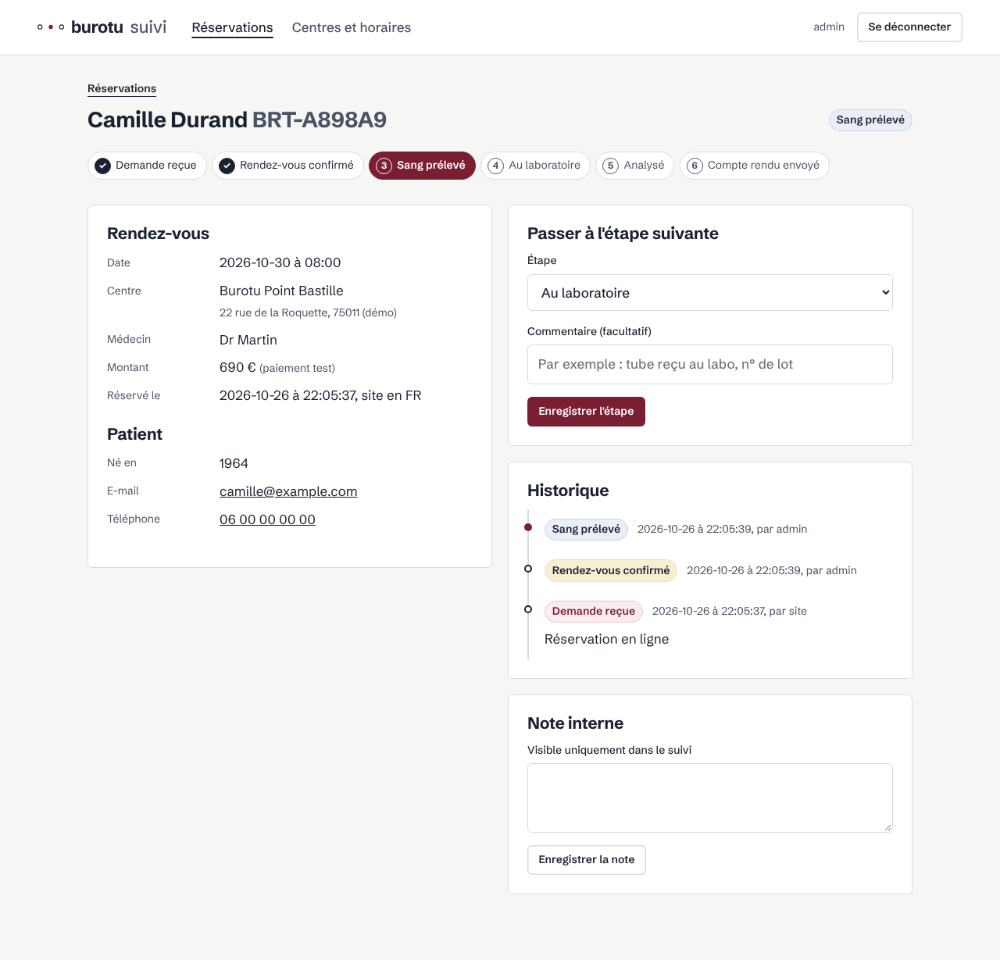

<p align="center">
  
</p>

<h1 align="center">Burotu</h1>

<p align="center">
  <strong>50 cancers. One blood draw.</strong><br>
  Multi-cancer early detection from cell-free DNA methylation, powered by Meta's Muse models.
</p>

<p align="center">
  <a href="https://burotu.com">burotu.com</a> ·
  <a href="#how-it-works">How it works</a> ·
  <a href="#meta-models">Meta models</a> ·
  <a href="#quick-start">Quick start</a> ·
  <a href="#version-française">Version française</a>
</p>

> [!IMPORTANT]
> **Demonstration prototype** built for the Meta Global AI Developer Hackathon 2026 (indie track).
> Burotu is not a medical device, is not clinically validated, has no CE marking and must not be
> used to make any medical decision. Nothing is sold: payments run in test mode only.

## Why

Most cancers are found late, when symptoms appear. Screening exists for only a handful of them
(breast, colorectal, cervical, sometimes lung), and each one needs its own exam. Yet tumours shed
fragments of their DNA into the bloodstream from early on, and that DNA carries a chemical
signature, **methylation**, that reveals both that it is cancerous and which tissue it comes from.

Burotu turns one blood draw into a search for those signatures.

## How it works

```
Blood draw at a partner site ─► Partner lab ─► burotu-bmc file ─► Burotu ─► Plain-language report
                                 targeted                          │
                                 bisulfite                         ├─ 1. Data quality check ...... Muse Spark
                                 sequencing                        ├─ 2. Cancer signal ........... dedicated classifier
                                                                   ├─ 3. Tissue of origin ........ dedicated classifier
                                                                   └─ 4. Report and Q&A .......... Muse Spark
```

1. A partner collection site takes two tubes of blood.
2. The partner lab isolates cell-free DNA from plasma and sequences a **targeted panel of 1,692
   CpG sites**, chosen because they are almost never methylated in healthy blood.
3. The lab returns a read-count file in the open [`burotu-bmc`](src/burotu/labformat.py) format.
4. A dedicated classifier looks for a cancer signal and its likely tissue of origin.
5. Muse Spark checks the data, then writes a report a patient can understand.

**Coverage.** The product targets 50 cancer types. The hackathon prototype starts with **8**:
lung, colorectal, breast, pancreas, liver, oesophagus and stomach, head and neck, prostate.

## Meta models

| Where | Model | Why a language model |
| --- | --- | --- |
| Lab file quality control | Muse Spark (Meta Model API) | Reads coverage statistics and lab metadata, explains what is wrong and what to rerun |
| Patient and doctor report | Muse Spark | Turns probabilities and marker regions into clear, careful language in EN, FR or ES |
| Questions on a result | Muse Spark | Answers follow-up questions grounded in the report |

The detection itself uses a tabular classifier: a language model is not the right tool to classify
thousands of numeric methylation values, and we would rather say so than pretend. The
[client](src/burotu/llm/client.py) speaks the OpenAI-compatible Meta Model API and falls back to a
mock mode without a key, so everything runs offline.

## Data

All public, no patient data collected.

| Role | Dataset |
| --- | --- |
| Tumour methylation, 8 types × 48 tumours | TCGA via the GDC portal (open access, Illumina 450K) |
| Healthy blood background, 164 adults | Hannum et al., *Mol Cell* 2013 — GEO GSE40279 |
| Real plasma for validation | Moss et al., *Nat Commun* 2018 — GEO GSE122126 |

Plasma samples are simulated by mixing real tumour profiles into real healthy blood at tumour
fractions from 0.01 % to 10 %, then sampling sequencing reads. People and tumours are split into
train and test **before** simulation and panel selection. Details in [docs/data.md](docs/data.md).

## The product

- **[burotu.com](https://burotu.com)** — one-page site in English, French and Spanish, with
  booking at partner collection sites.
- **admin.burotu.com** — tracking for every sample: request, confirmed appointment, blood drawn,
  in the lab, analysed, report sent, with a timestamped history.

<p align="center"></p>

## Quick start

```bash
make install        # Python 3.11+
make check          # lint + tests, same as CI
make dev            # http://localhost:8000 (site) · http://admin.localhost:8000 (tracking, password "dev")
```

Data pipeline (about 5 GB downloaded from GDC and GEO):

```bash
make data           # TCGA tumours, whole blood, real plasma
make reference      # targeted panel and train/test split
make demo-samples   # simulated lab files for the demo
```

`make help` lists every command.

## Repository

```
src/burotu/        pipeline: data, panel, cfDNA simulator, Meta client, lab format
src/burotu_web/    burotu.com (one-pager) and admin.burotu.com (tracking)
tests/             pipeline, site, booking, tracking, security
deploy/            production compose, Caddy block, deploy script
docs/              architecture, data and method, deployment
.github/workflows  CI (lint, tests, image) and continuous deployment
```

Every push to `main` runs the tests, publishes `ghcr.io/zoukmar/burotu-web:<sha>` and deploys it
over SSH, with automatic rollback if the site does not answer. See
[docs/deployment.md](docs/deployment.md).

## Roadmap

- [x] Public data pipeline, targeted panel, cfDNA simulator
- [x] burotu.com and sample tracking, continuous deployment
- [ ] Cancer signal and tissue-of-origin classifier, validated on real plasma
- [ ] Muse Spark quality control and patient report
- [ ] From 8 to 50 cancer types

---

## Version française

**50 cancers. Une seule prise de sang.** Burotu recherche dans le sang les traces d'ADN laissées
par les tumeurs, grâce à leur signature de méthylation, et indique d'où vient un signal.

> [!IMPORTANT]
> **Prototype de démonstration** réalisé pour le Meta Global AI Developer Hackathon 2026.
> Ce n'est pas un dispositif médical : test non validé cliniquement, sans marquage CE, à ne pas
> utiliser pour une décision médicale. Rien n'est vendu, le paiement est en mode test.

**Fonctionnement.** Une prise de sang chez un préleveur partenaire ; le laboratoire séquence un
panel ciblé de 1 692 sites CpG sur l'ADN circulant et renvoie un fichier `burotu-bmc` ; un
classifieur dédié détecte un signal de cancer et son organe d'origine probable ; **Muse Spark**
(Meta) contrôle la qualité des données et rédige un compte rendu en langage clair.

**Couverture.** Le produit vise 50 types de cancer. Le prototype commence par 8 : poumon,
colorectal, sein, pancréas, foie, œsophage et estomac, tête et cou, prostate.

**Données.** Uniquement publiques : TCGA (portail GDC), Hannum et al. 2013 (GSE40279) pour le sang
sain, Moss et al. 2018 (GSE122126) pour la validation sur plasma réel. Les plasmas d'entraînement
sont simulés en mélangeant des profils tumoraux réels à du sang sain réel.

**Démarrer.**

```bash
make install && make check && make dev
```

Documentation détaillée (en français) : [architecture](docs/architecture.md) ·
[données et méthode](docs/data.md) · [déploiement](docs/deployment.md).
